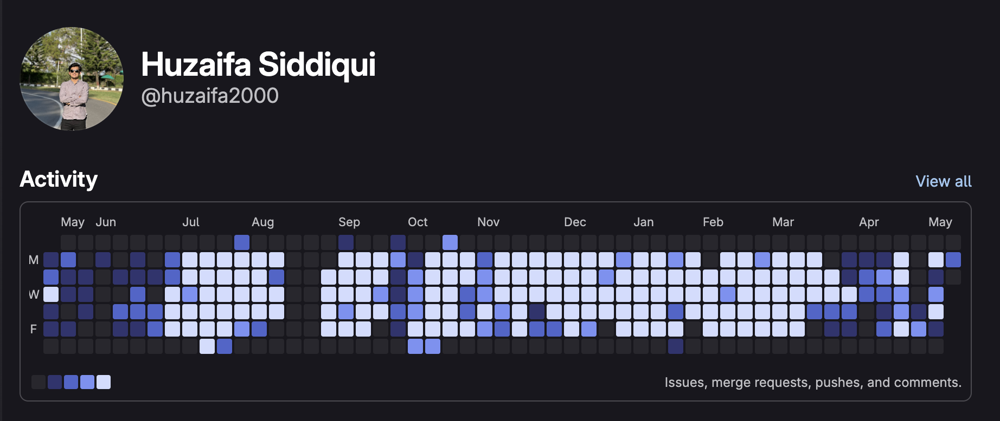

# Hi, I'm Muhammad Huzaifa Siddiqui

**Full-Stack Software Engineer** · Associate Tech Lead (Partner) at [Turing Technologies](https://www.turingtechnologies.org/) · Based in Islamabad, Pakistan

I build and ship full-stack platform features end-to-end — from REST API design and frontend architecture to developer enablement. I'm an expert in third-party integrations and AI LLM integrations and RAG architectures. I also run AI-for-Devs workshops for my team.

[View My Website](https://huzaifa-sidd.vercel.app/)
---

## Tech Stack

---

## Connect

---

## Where I actually code

Most of my day-to-day work lives on **GitLab**, not GitHub — so this profile's contribution graph doesn't tell the full story. Here's a snapshot of my GitLab activity:

